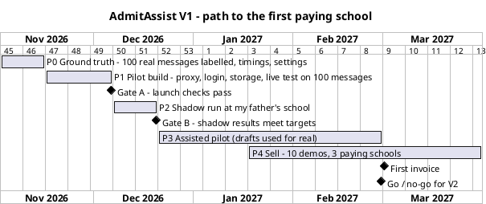

# 07. Roadmap: V1 in detail, V2 and V3 as sketches

> AdmitAssist | MBA ZG583 Management of AI Products | GOLLAPUDI SIVA NAGA JNANA TEJA | 2025MB26205 | GitHub: jnanateja009

The faculty's rule: you cannot sell until V1 exists, so the plan runs until the first money. V1 is planned week by week to the first invoice (1 Mar 2027). V2 and V3 are sketches with the gate that must be passed before each starts.

I have a full-time job, so I budget about 10 hours a week, more in the build weeks. Diwali (8 Nov 2026) and Sankranti (14 to 16 Jan 2027) are inside the plan; no milestone falls on them.

## 1. V1: from prototype to first paying school (2 Nov 2026 to 31 Mar 2027)

[View rendered plan](https://www.plantuml.com/plantuml/svg/RPD1Zzem48Nl-HNljhiIeNReigYdPGz5gjGAYMelg48c6HApnexi2Ll-VITPgWheBRPctlVcZVESs4IkZMU6ccsEUjCwupV3HNQ7Lut-30xOsPWOaOxaEnfZtd4JuXSiiC8FVCDFsXlS5wfu_FvIJ0lr-336KO-LL6v3nz0AJUXYGaiHxqHlC2xuEjcAS3XX7xRZZ2qxmhmwM9wdP0Kd_1ojuQPtm0sTNRJcP7sDL3OXk6mPmvvAnZ1AWdYOvbhdgiZQQ3sdqeXgZtIdRBrKMCJG-GeSPGIHrqh9MCRXG2cPcXASsP9pL8t0zY2WD48Yvlxhroq5HiJ8L__kzADmD9RM1SQsiwxgfuZXzsa45shhHOz359QSxP7094C5FrZvw-A6fAVNf29NqsozC2oX2S6PpfSDoeRADydP9D5eJDkIlsnO5bWrfWhlY9s7uJx_dMHCyIwTCxs2Iz_JBRnGP_YBmDDPaLBdfEz0n129clW_BlhEvGGVIwOAxP3KVHNDJdgx95Ux48UjFDnOAVI5bITPGLxCHF0pLhAsOQEew11aRPFBft8HgZHAgBDhiKa-qTdww_3Eh3y6MzB504E9af95m2VuaDTXCFjQN9SDjfv5-kDl-WC0)

| Phase | Dates | My hours | What gets done | Exit criteria (all must be true) |
|---|---|---|---|---|
| P0 Ground truth | 2 Nov to 15 Nov 2026 (2 weeks) | 16 | School owner's written consent; 100 past inquiries exported and anonymised (D2); coordinator labels them, I label 30 for the kappa check; stopwatch on 20 inquiries (B2 baseline); count of last season's inquiries by month and channel (A1); school settings file filled and approved by the owner (Q2, Q3) | 100 labelled messages; kappa 0.70 or more; the school's own settings file (its version 1.0.0) signed off by the owner |
| P1 Pilot build | 16 Nov to 6 Dec 2026 (3 weeks) | 52 (breakdown in 03b section 1; 2 days of leave) | Server with API proxy (key never on the office computer), one login per person, multi-school database, nightly backup, monthly AI cap, threading and close-out rules, deletion on request, export, retention job, parent notice (03b sections 1 and 12); 75-message sensitive set (D3); live evaluation of 4 models on D2 + D3, including name-swap, stability and draft-correctness checks; provider's no-training terms on file (Q4) | **Gate A** passed (05, section 6.4); software acceptance S1 to S4 passed (03b section 3) |
| P2 Shadow run | 7 Dec to 20 Dec 2026 (2 weeks) | 10 | Coordinator pastes every new inquiry into AdmitAssist but replies the old way; I compare AdmitAssist's routes and priorities with what the coordinator did | **Gate B** passed |
| P3 Assisted pilot | 21 Dec 2026 to 28 Feb 2027 (10 weeks) | 40 | Drafts used for real; weekly 30-minute review of the log with the coordinator; settings tuned through FR-23 only | Go / no-go criteria met on 28 Feb 2027 |
| V1.1 prompt update | by 15 Mar 2027 | (inside P3/P4 hours) | `read_v1.1` (four fixes, 03b section 4), after FR-23 | Shipped before 2 Apr 2027, the first day "joining in June" falls inside the 60-day window |
| P4 First paying schools | 18 Jan to 31 Mar 2027 (10 weeks, overlaps P3) | 40 | After 4 weeks of pilot results: 10 demos to schools in my father's network and the local private school association; offer Rs 1,499 per season month | **First invoice on 1 Mar 2027; 3 paying schools by 31 Mar 2027** |

Total: about 158 hours over 22 weeks.

Cash I spend before the first invoice (ASSUMED budget):

| Item | Amount |
|---|---|
| AI calls for evaluation runs (4 models x about 160 messages) | Rs 553 |
| Server December to March (4 x Rs 2,000) | Rs 8,000 |
| Domain (1 year) | Rs 1,000 |
| Coordinator overtime for labelling | Rs 200 |
| Coordinator weekly reviews (10 x Rs 100) | Rs 1,000 |
| Travel for 10 demos (10 x Rs 250) | Rs 2,500 |
| **Total** | **Rs 13,253** |

Three schools paying for March to May bring Rs 13,491 of revenue but only about Rs 10,143 of contribution (9 school-months x Rs 1,127), so the season does not fully pay this back. The remaining Rs 3,110 comes back in about 5 quiet months (3 schools x Rs 212), by about October 2027, if all three stay.

What I do if a gate fails: the next phase moves by the length of the fix, and the selling phase moves with it. I do not start P4 without at least 4 weeks of pilot data, because "it works at my father's school" is the only proof I will have.

## 2. V2: "the inbox fills itself" (Apr to Sep 2027), sketch

Start condition: go decision on 28 Feb 2027 and 3 paying schools.

| Theme | What | Why now |
|---|---|---|
| Messages arrive on their own | WhatsApp Business API inbox through one partner platform; still no automatic sending | Removes copy-paste, the main friction I expect from the pilot |
| Parent's language | Draft in Telugu or Hindi when the parent wrote in it, with checks rebuilt for those scripts | Decision rule: first in V2 if more than 20% of pilot inquiries are not in English (my written samples are not evidence of the real mix) |
| Follow-up | Reminder when a HIGH inquiry has no visit after 7 days | Most lost admissions are lost after the first reply |
| Voice notes | Transcription of WhatsApp voice notes before reading | Decision rule: built in V2 only if more than 10% of pilot inquiries are voice notes |
| Self-serve setup | Settings wizard and short videos | Support time is the cost that can sink the business (06) |
| DPDP readiness | Consent step for children's health information on the web form and in WhatsApp, consent record, by **30 Apr 2027** (notice, deletion on request, export and retention already ship in V1) | Children's-data duties apply from about 13 May 2027, inside the first paid season |
| Price | Same plans; WhatsApp message fees passed through at cost | Keep the price simple |
| Target | 25 paying schools by 30 Sep 2027 | |

## 3. V3: "from inquiry to admission" (Oct 2027 to Mar 2028), sketch

Start condition: 25 paying schools, support at or under 1 hour per school per month, no blocker metric failed in V2.

| Theme | What |
|---|---|
| Funnel report | Inquiry to visit to application to admission, by channel and class, for the owner |
| Outcome-linked price trial | Rs 500 per admitted child whose first inquiry went through AdmitAssist, capped at Rs 15,000 a year, offered to 5 schools |
| Plug into a bigger platform | Offer AdmitAssist's reading and checks as a plug-in to one WhatsApp platform or school ERP, instead of competing with them |
| Limited automatic replies | Only for one category (for example "office hours" questions), only after 6 months of 95% or more of those drafts approved without edits, and only if the school owner switches it on |
| Target | 100 schools by 31 Mar 2028 |

## 4. What I will not build, and why

| Not building | Reason |
|---|---|
| Admission decisions, seat allocation, fee collection | Those are the school's decisions and its ERP's job |
| A parent-facing chatbot | A wrong automatic answer to a parent costs more than it saves; that is the core of this design |
| My own language model | No data advantage; API prices keep falling |
